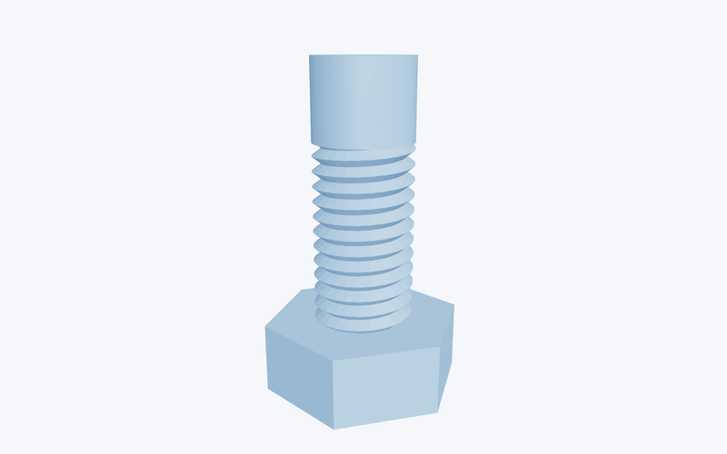
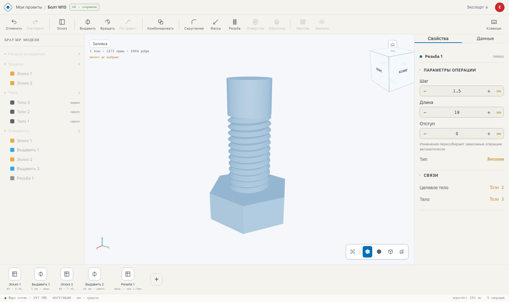
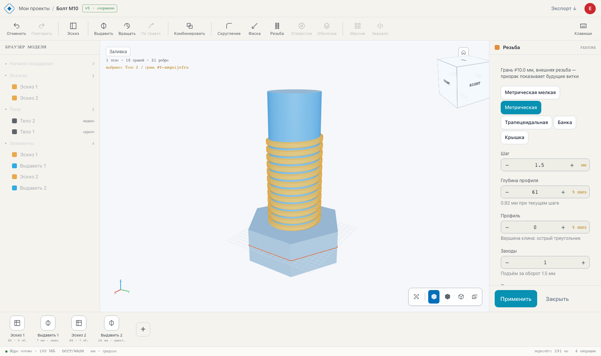
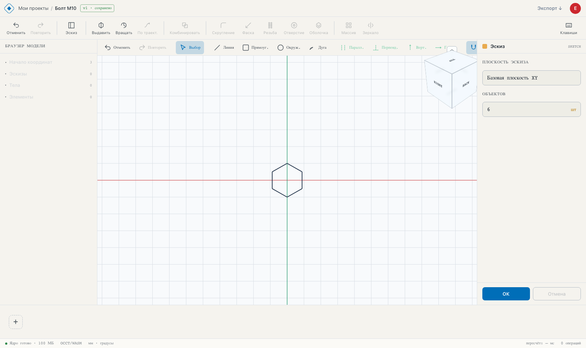

# Krometra

[Русский](./README.md) · **English** · [中文](./README.zh-CN.md)

[](https://github.com/krometra/krometra/actions/workflows/ci.yml)
[](./LICENSE.md)

A browser-based engineering CAD system for parametric 3D modeling, inspired by Fusion 360 and Onshape.

Try it: **<https://krometra.ru>**

<p align="center"></p>



## Vision

Professional parametric 3D modeling in the browser: no installation, server licenses or GPU requirements beyond a modern browser.

The OpenCASCADE/WebAssembly geometry kernel runs in a browser Web Worker. It builds exact B-rep geometry on the client and sends tessellation to the viewport; the server stores documents, permissions and project files (STEP and meshes) and does not calculate geometry. The architecture is designed from the start for multiple users (accounts with projects, sharing and public projects) and future collaboration with Yandex sign-in.

## Status

🚧 **Active development, early alpha.** Already working:

- OpenCASCADE/WASM B-rep kernel in the browser: extrude (join/cut/new body; by distance, through all, up to a face/body or in both directions), revolve, Boolean operations, fillet and chamfer, threads, STEP import and export, STL export, and stable face and edge names.
- 2D sketcher with constraint solver: primitives, snapping, construction geometry, sketches on arbitrary planar faces that follow the face when rebuilt, and multi-contour profiles (holes).
- Operation history (timeline), authentication (OAuth2 password flow, refresh-token rotation, rate limiting), per-user project isolation and STEP/STL export.
- Tests: Vitest for pure logic and kernel operations using real OCCT/WASM, pytest for the backend, and an end-to-end scenario modeling a real part ([`web/e2e/soap-dish.spec.ts`](./web/e2e/soap-dish.spec.ts)).

In progress: patterns, holes, and deletion and suppression of operations. See [`.docs/ROADMAP.md`](./.docs/ROADMAP.md) for the roadmap and [`.docs/gdd.md`](./.docs/gdd.md) for the full product description.





## Technology

| Layer | Technology |
|------|-----------|
| **Frontend** | Vue 3 (Composition API) + TypeScript, Three.js, Vue Router, zag.js, CSS Modules, VueUse |
| **Backend** | Python 3.12, FastAPI, SQLAlchemy 2.0 (async), Alembic |
| **Data** | PostgreSQL 16, Redis |
| **Storage** | S3-compatible: SeaweedFS in development and CI, MinIO in production |
| **Authentication** | OAuth2 password flow, JWT access + opaque refresh with rotation and family tracking |
| **Geometry** | OpenCASCADE/WASM in a Web Worker (replicad) |

## Architecture

Monorepo:

```
backend/   FastAPI: API, authentication, services, models, migrations
web/       Vue 3: viewport, design system, pages, composables
docker-compose.yml   PostgreSQL + Redis + S3 storage + backend + web (nginx with frontend build)
```

See [`.docs/gdd.md`](./.docs/gdd.md) (sections 4.2 and 4.3) and [`CLAUDE.md`](./CLAUDE.md) for the detailed structure.

## Quick start

Requirements: Docker + Docker Compose, Node.js 20+ (for the frontend in dev mode).

```bash
# 1. Copy environment variables
cp .env.example .env

# 2. Start PostgreSQL, Redis, S3 storage (SeaweedFS), backend and built frontend
make up

# 3. Apply database migrations
make migrate

# 4. For frontend development: Vite dev server on :5173 (proxies /api to :8000)
make frontend-shell
```

The OpenCASCADE/WASM geometry kernel runs in the browser; OCCT does not need to be installed on the server or locally. The first editor visit downloads WASM (~7 MB gzipped); subsequent visits use the cache.

After startup:

- Built frontend (`web` container): <http://localhost> (change the port with `WEB_PORT` in `.env`)
- Vite dev server: <http://localhost:5173>
- Backend API: <http://localhost:8000> (Swagger: <http://localhost:8000/docs>)
- Health check: <http://localhost:8000/api/health>

The development stack listens only on `127.0.0.1` and uses `DEBUG=true` and default passwords from `.env.example`: do not expose it publicly. For a server use `docker-compose.prod.yml` and `scripts/deploy.sh`; the backend there refuses to start with default passwords.

## Development commands

```bash
make up          # start the stack
make down        # stop
make rebuild     # rebuild images and restart
make logs        # logs
make migrate     # apply migrations
make migrate-create name="add_documents"   # create a migration
make db-shell    # psql
make clean       # stop and remove volumes/caches

make backend-shell    # run backend locally without Docker
make frontend-shell  # run frontend locally (Vite)
```

Administrator (the `/admin` page shows user and project analytics): an email listed in `ADMIN_EMAILS` in `.env` receives the role at the next sign-in, or grant it explicitly in the backend container:

```bash
docker compose exec app python -m app.cli admin grant you@example.com    # revoke removes the role; list lists administrators
```

Frontend build and checks (from `web/`):

```bash
npm run build    # file-size check + types (vue-tsc) + production build
npm run lint     # ESLint, 0 warnings
npm test         # vitest
npm run e2e      # Playwright (requires the stack and dev server)
```

## Documentation

- [`.docs/gdd.md`](./.docs/gdd.md) — product design document: vision, MVP scope, architecture and roadmap.
- [`.docs/ROADMAP.md`](./.docs/ROADMAP.md) — development phases and engineering quality analysis.
- [`CLAUDE.md`](./CLAUDE.md) — codebase conventions and commands.
- [`AGENTS.md`](./AGENTS.md) — development best practices.
- [`LEGACY.md`](./LEGACY.md) — known technical debt: large files, duplication and workarounds.

## Contributing

Report bugs and suggestions in [Issues](https://github.com/krometra/krometra/issues). See [`CONTRIBUTING.md`](./CONTRIBUTING.md) for the development workflow. Report vulnerabilities privately as described in [`SECURITY.md`](./SECURITY.md), not in Issues.

## License

[Functional Source License 1.1 converting to Apache-2.0](./LICENSE.md) (FSL-1.1-ALv2, the same license used by Sentry and GitButler).

This is **source-available**, not OSI open source: the code is available to read and modify, but competing commercial use is restricted.

In practice:

- **Allowed:** use inside your company (including employee access over the internet), study, modification, non-commercial education and research, and providing professional services to licensees.
- **Not allowed:** offering Krometra or its functionality to third parties as a commercial product or service competing with the project.
- **After two years**, each released version automatically converts to Apache-2.0 and becomes fully open.

Third-party components have their own licenses, listed in [`web/public/THIRD_PARTY_NOTICES.txt`](./web/public/THIRD_PARTY_NOTICES.txt). The OpenCASCADE geometry kernel (`replicad-opencascadejs`) is licensed under LGPL-2.1 and delivered as a separate WASM file that can be replaced with your own build.

For commercial licensing outside these terms, contact the author via [Issues](https://github.com/krometra/krometra/issues) or their GitHub profile.
