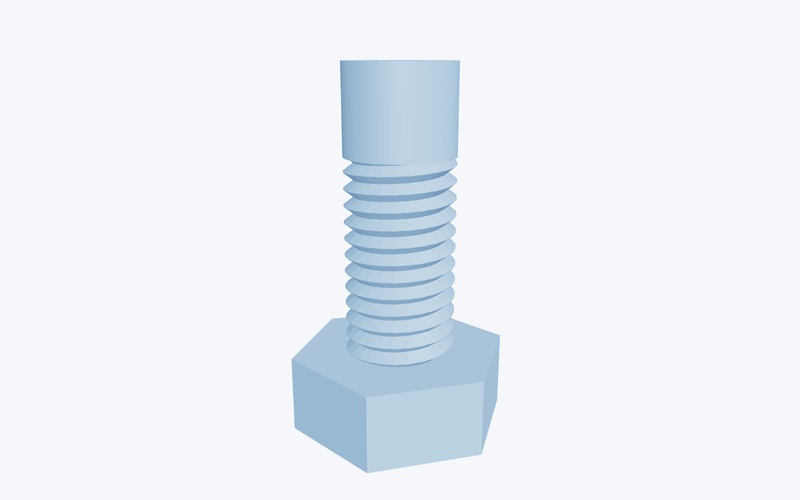
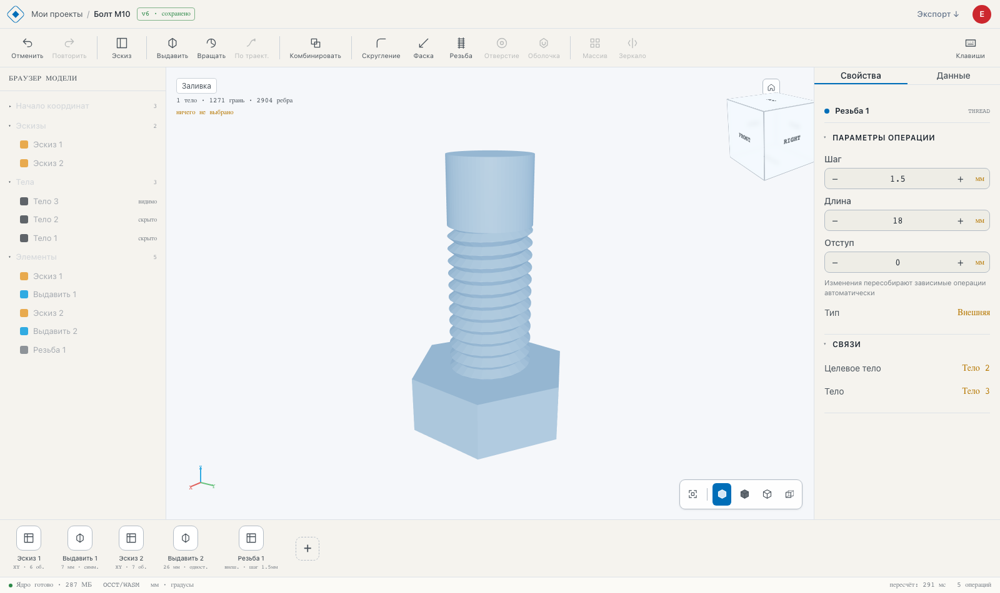
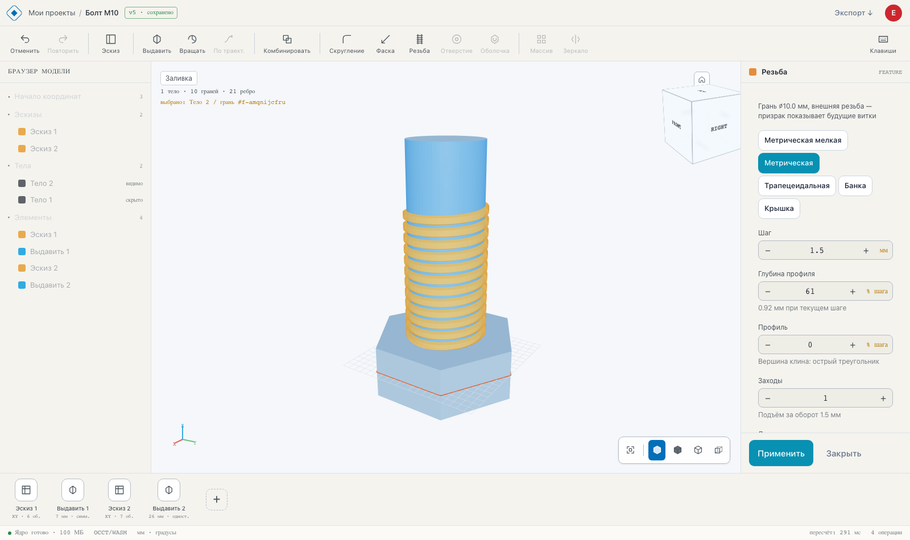
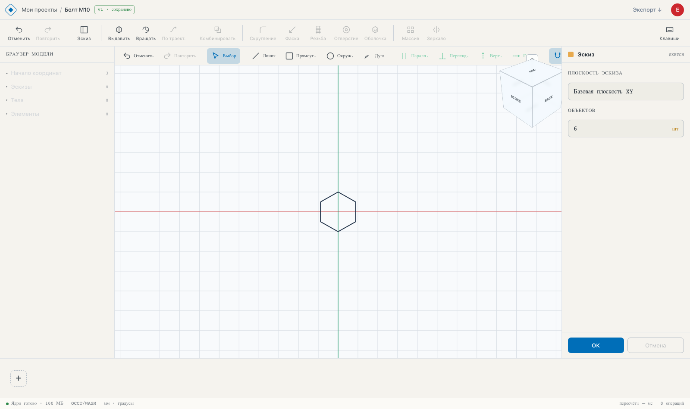

# Крометра

[](https://github.com/krometra/krometra/actions/workflows/ci.yml)
[](./LICENSE.md)

Браузерная инженерная CAD-система для параметрического 3D-моделирования, вдохновлённая Fusion 360 и Onshape.

Попробовать: **<https://krometra.ru>**

<p align="center"></p>



**English:** Krometra is a browser-based parametric 3D CAD system (think Onshape): a real OpenCASCADE B-rep kernel compiled to WebAssembly and running in a browser Web Worker, a Vue 3 + Three.js client, a 2D sketcher with a constraint solver, extrude/revolve/fillet/chamfer/boolean operations, persistent topological naming, and STEP/STL export. Source-available under FSL-1.1-ALv2 (not an OSI open-source license: you may read, modify and use the code, including internally at your company, but not to offer a competing product; each release converts to Apache-2.0 two years after publication). Hosted version: <https://krometra.ru>. Documentation is currently in Russian; contributions are welcome in both languages.

## Видение

Профессиональное параметрическое 3D-моделирование прямо в браузере — без установки, без серверных лицензий, без зависимостей от GPU на клиенте сверх современного браузера.

Геометрическое ядро (OpenCASCADE, WebAssembly) работает в браузере в Web Worker: точный B-rep строится на клиенте, во вьюпорт уходит тесселяция, а сервер хранит документ, права и файлы проекта (STEP и меш) и геометрию не считает. Архитектура с первого дня закладывается под многопользовательский режим (личные кабинеты с проектами, возможность делиться и делать проекты общедоступными) и будущую коллаборацию со входом через yandex.

## Статус

🚧 **Активная разработка, ранняя альфа.** Уже работает:

- B-rep ядро OpenCASCADE/WASM в браузере: выдавливание (приклеить/вырезать/новое тело; на расстояние, насквозь, до грани/тела, в обе стороны), вращение, boolean-операции, скругление и фаска, резьба, импорт и экспорт STEP, экспорт STL, стабильные имена граней и рёбер.
- 2D-скетчер с решателем ограничений: примитивы, привязки, вспомогательная геометрия, эскиз на произвольной плоской грани, который следует за гранью при пересборке, мультиконтурные профили (отверстия).
- Дерево операций (timeline), аутентификация (OAuth2 password flow, ротация refresh-токенов, rate limiting), проекты с изоляцией по пользователям, экспорт STEP/STL.
- Тесты: vitest для чистой логики и операций ядра на реальном OCCT/WASM, pytest для backend, e2e-сценарий сборки реальной детали ([`web/e2e/soap-dish.spec.ts`](./web/e2e/soap-dish.spec.ts)).

В работе: массивы, отверстия, удаление и подавление операций. План — в [`.docs/ROADMAP.md`](./.docs/ROADMAP.md), полное описание продукта — в [`.docs/gdd.md`](./.docs/gdd.md).





## Технологии

| Слой | Технологии |
|------|-----------|
| **Frontend** | Vue 3 (Composition API) + TypeScript, Three.js, Vue Router, zag.js, CSS Modules, VueUse |
| **Backend** | Python 3.12, FastAPI, SQLAlchemy 2.0 (async), Alembic |
| **Данные** | PostgreSQL 16, Redis |
| **Хранилище** | S3-совместимое: SeaweedFS в разработке и CI, MinIO на проде |
| **Аутентификация** | OAuth2 password flow, JWT access + opaque refresh с ротацией и family tracking |
| **Геометрия** | OpenCASCADE/WASM в Web Worker (replicad) |

## Архитектура

Монорепо:

```
backend/   FastAPI: API, аутентификация, сервисы, модели, миграции
web/        Vue 3: вьюпорт, дизайн-система, страницы, composables
docker-compose.yml   PostgreSQL + Redis + S3-хранилище + backend + web (nginx со сборкой фронта)
```

Подробная структура — в [`.docs/gdd.md`](./.docs/gdd.md) (разделы 4.2 и 4.3) и в [`CLAUDE.md`](./CLAUDE.md).

## Быстрый старт

Требования: Docker + Docker Compose, Node.js 20+ (для фронтенда в dev-режиме).

```bash
# 1. Скопировать переменные окружения
cp .env.example .env

# 2. Поднять стек: PostgreSQL, Redis, S3-хранилище (SeaweedFS), backend и собранный фронт
make up

# 3. Применить миграции БД
make migrate

# 4. Для разработки фронтенда — Vite dev-сервер на :5173 (проксирует /api на :8000)
make frontend-shell
```

Геометрическое ядро (OpenCASCADE/WASM) работает в браузере — ставить OCCT на сервер или локально не нужно. Первое открытие редактора скачивает WASM (~7 МБ в gzip), дальше он берётся из кэша.

После запуска:

- Собранный фронт (контейнер `web`): <http://localhost> (порт меняется `WEB_PORT` в `.env`)
- Vite dev-сервер: <http://localhost:5173>
- Backend API: <http://localhost:8000> (Swagger: <http://localhost:8000/docs>)
- Health-check: <http://localhost:8000/api/health>

Dev-стек слушает только `127.0.0.1` и работает с `DEBUG=true` и паролями по умолчанию из `.env.example`: наружу его выставлять нельзя. Для сервера — `docker-compose.prod.yml` и `scripts/deploy.sh`, там backend с паролями по умолчанию не стартует.

## Команды разработки

```bash
make up          # поднять стек
make down        # остановить
make rebuild     # пересобрать образы и поднять заново
make logs        # логи
make migrate     # применить миграции
make migrate-create name="add_documents"   # создать миграцию
make db-shell    # psql
make clean       # остановить и удалить тома/кэши

make backend-shell    # запустить backend локально без Docker
make frontend-shell   # запустить frontend локально (Vite)
```

Администратор (страница `/admin` с аналитикой по пользователям и проектам): почта в `ADMIN_EMAILS` в `.env` получает роль при следующем входе, либо явно командой в контейнере backend:

```bash
docker compose exec app python -m app.cli admin grant you@example.com    # revoke - снять, list - список
```

Сборка и проверки фронтенда (из `web/`):

```bash
npm run build    # проверка размера файлов + типов (vue-tsc) + production-сборка
npm run lint     # ESLint, 0 warnings
npm test         # vitest
npm run e2e      # Playwright (нужен поднятый стек и dev-сервер)
```

## Документация

- [`.docs/gdd.md`](./.docs/gdd.md) — Product Design Document: видение, scope MVP, архитектура, план развития.
- [`.docs/ROADMAP.md`](./.docs/ROADMAP.md) — фазы развития и инженерная аналитика качества.
- [`CLAUDE.md`](./CLAUDE.md) — конвенции и команды для работы с кодовой базой.
- [`AGENTS.md`](./AGENTS.md) — лучшие практики разработки.
- [`LEGACY.md`](./LEGACY.md) — известный техдолг: крупные файлы, дублирование, обходы.

## Участие

Баги и предложения — в [Issues](https://github.com/krometra/krometra/issues). Порядок работы с кодом — в [`CONTRIBUTING.md`](./CONTRIBUTING.md). Об уязвимостях — приватно, как описано в [`SECURITY.md`](./SECURITY.md), не через Issues.

## Лицензия

[Functional Source License 1.1 с переходом в Apache-2.0](./LICENSE.md) (FSL-1.1-ALv2, та же лицензия у Sentry и GitButler).

Это **source-available**, а не open source в смысле OSI: код открыт для чтения и изменений, но есть ограничение на конкурирующее коммерческое использование.

Что это значит на практике:

- **Можно:** использовать внутри своей компании (в том числе с доступом сотрудников через интернет), изучать, модифицировать, использовать в некоммерческом образовании и исследованиях, оказывать профессиональные услуги лицензиатам.
- **Нельзя:** предоставлять Крометру (или её функциональность) третьим лицам как коммерческий продукт или сервис, конкурирующий с проектом.
- **Через 2 года** каждая выпущенная версия автоматически переходит под Apache-2.0 и становится полностью свободной.

Сторонние компоненты распространяются под своими лицензиями — список в [`web/public/THIRD_PARTY_NOTICES.txt`](./web/public/THIRD_PARTY_NOTICES.txt). Геометрическое ядро OpenCASCADE (пакет `replicad-opencascadejs`) — под LGPL-2.1: оно поставляется отдельным WASM-файлом, который можно заменить своей сборкой.

Для коммерческого лицензирования вне этих условий — свяжитесь с автором через [Issues](https://github.com/krometra/krometra/issues) или профиль GitHub.
