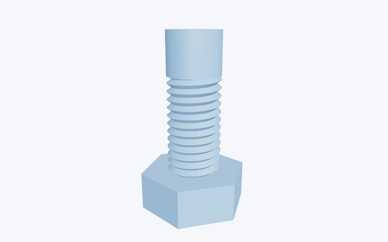
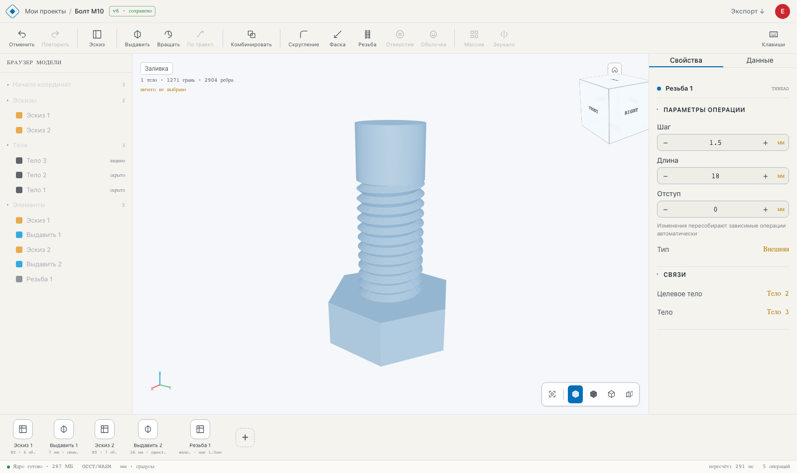
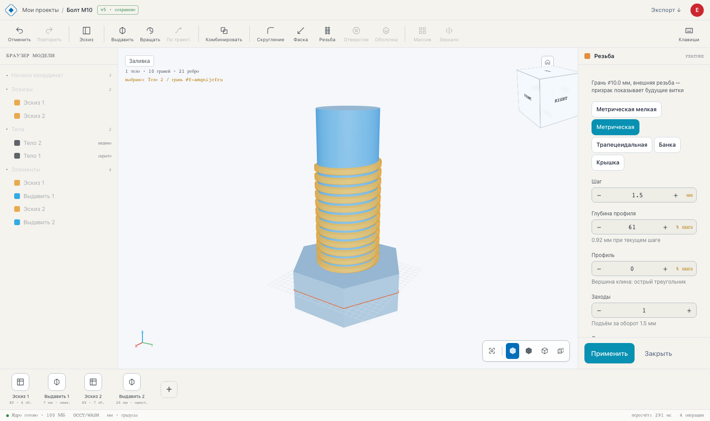
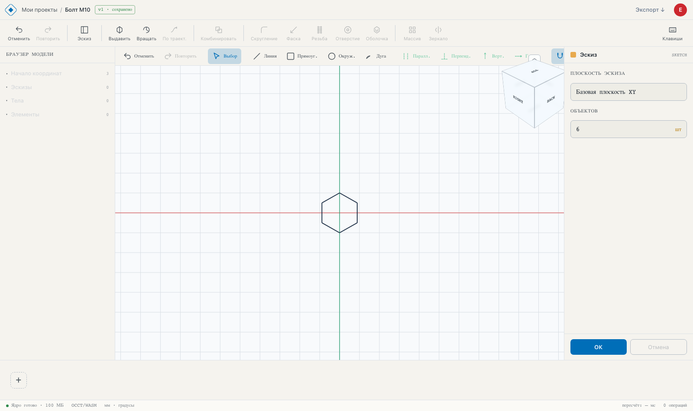

# Krometra

[Русский](./README.md) · [English](./README.en.md) · **中文**

[](https://github.com/krometra/krometra/actions/workflows/ci.yml)
[](./LICENSE.md)

一款基于浏览器的参数化 3D 工程 CAD 系统，灵感来自 Fusion 360 和 Onshape。

在线体验：**<https://krometra.ru>**

<p align="center"></p>



## 愿景

直接在浏览器中进行专业参数化 3D 建模：无需安装、无需服务器许可证，客户端只需能够运行现代浏览器。

几何内核 OpenCASCADE/WebAssembly 在浏览器 Web Worker 中运行：精确的 B-rep 在客户端构建，视口接收其三角网格；服务器负责存储文档、权限和项目文件（STEP 与网格），不计算几何。从一开始，架构即面向多用户模式（拥有项目的个人账户、共享与公开项目）以及未来通过 Yandex 登录的协作功能。

## 状态

🚧 **积极开发中，早期 Alpha 版。** 已实现：

- 浏览器中的 OpenCASCADE/WASM B-rep 内核：拉伸（合并/切除/新实体；按距离、贯穿、到面/实体、双向）、旋转、布尔运算、圆角、倒角、螺纹、STEP 导入和导出、STL 导出，以及稳定的面和边命名。
- 带约束求解器的二维草图：基本图形、捕捉、构造几何、可在重建时跟随任意平面面变化的草图，以及多轮廓剖面（孔）。
- 操作历史（时间线）、身份验证（OAuth2 密码流程、刷新令牌轮换、速率限制）、按用户隔离的项目和 STEP/STL 导出。
- 测试：使用真实 OCCT/WASM 的 Vitest 纯逻辑与内核操作测试、后端 pytest，以及构建真实零件的端到端场景（[`web/e2e/soap-dish.spec.ts`](./web/e2e/soap-dish.spec.ts)）。

进行中：阵列、孔，以及删除和抑制操作。开发计划见 [`.docs/ROADMAP.md`](./.docs/ROADMAP.md)，完整产品说明见 [`.docs/gdd.md`](./.docs/gdd.md)。





## 技术栈

| 层 | 技术 |
|------|-----------|
| **前端** | Vue 3（Composition API）+ TypeScript、Three.js、Vue Router、zag.js、CSS Modules、VueUse |
| **后端** | Python 3.12、FastAPI、SQLAlchemy 2.0（异步）、Alembic |
| **数据** | PostgreSQL 16、Redis |
| **存储** | S3 兼容存储：开发及 CI 使用 SeaweedFS，生产环境使用 MinIO |
| **身份验证** | OAuth2 密码流程、JWT 访问令牌和支持轮换及令牌族跟踪的不透明刷新令牌 |
| **几何** | Web Worker 中的 OpenCASCADE/WASM（replicad） |

## 架构

单一代码库：

```
backend/   FastAPI：API、身份验证、服务、模型、迁移
web/       Vue 3：视口、设计系统、页面、composable
docker-compose.yml   PostgreSQL + Redis + S3 存储 + 后端 + web（带前端构建的 nginx）
```

详细结构见 [`.docs/gdd.md`](./.docs/gdd.md)（第 4.2 和 4.3 节）及 [`CLAUDE.md`](./CLAUDE.md)。

## 快速开始

要求：Docker + Docker Compose、Node.js 20+（前端开发模式使用）。

```bash
# 1. 复制环境变量
cp .env.example .env

# 2. 启动 PostgreSQL、Redis、S3 存储（SeaweedFS）、后端和构建后的前端
make up

# 3. 应用数据库迁移
make migrate

# 4. 前端开发：在 :5173 启动 Vite 开发服务器（将 /api 代理到 :8000）
make frontend-shell
```

OpenCASCADE/WASM 几何内核运行在浏览器中，无需在服务器或本地安装 OCCT。首次打开编辑器时会下载 WASM（gzip 压缩后约 7 MB），之后使用缓存。

启动后：

- 构建后的前端（`web` 容器）：<http://localhost>（在 `.env` 中通过 `WEB_PORT` 更改端口）
- Vite 开发服务器：<http://localhost:5173>
- 后端 API：<http://localhost:8000>（Swagger：<http://localhost:8000/docs>）
- 健康检查：<http://localhost:8000/api/health>

开发环境仅监听 `127.0.0.1`，并使用 `DEBUG=true` 和 `.env.example` 中的默认密码，不得暴露到公网。服务器应使用 `docker-compose.prod.yml` 和 `scripts/deploy.sh`，其中的后端不会使用默认密码启动。

## 开发命令

```bash
make up          # 启动服务
make down        # 停止
make rebuild     # 重新构建镜像并启动
make logs        # 查看日志
make migrate     # 应用迁移
make migrate-create name="add_documents"   # 创建迁移
make db-shell    # psql
make clean       # 停止并删除卷和缓存

make backend-shell    # 不使用 Docker 在本地运行后端
make frontend-shell   # 在本地运行前端（Vite）
```

管理员（`/admin` 页面提供用户和项目分析）：将邮箱加入 `.env` 的 `ADMIN_EMAILS` 后，该用户下次登录时获得角色；也可在后端容器中显式授予：

```bash
docker compose exec app python -m app.cli admin grant you@example.com    # revoke 撤销角色，list 列出管理员
```

前端构建与检查（在 `web/` 目录中）：

```bash
npm run build    # 文件大小检查 + 类型检查（vue-tsc）+ 生产构建
npm run lint     # ESLint，0 条警告
npm test         # vitest
npm run e2e      # Playwright（需要启动服务和开发服务器）
```

## 文档

- [`.docs/gdd.md`](./.docs/gdd.md) — 产品设计文档：愿景、MVP 范围、架构和发展计划。
- [`.docs/ROADMAP.md`](./.docs/ROADMAP.md) — 开发阶段和工程质量分析。
- [`CLAUDE.md`](./CLAUDE.md) — 代码库约定和命令。
- [`AGENTS.md`](./AGENTS.md) — 开发最佳实践。
- [`LEGACY.md`](./LEGACY.md) — 已知技术债务：大型文件、重复代码和权宜方案。

## 参与贡献

请在 [Issues](https://github.com/krometra/krometra/issues) 中报告错误和提出建议。开发流程见 [`CONTRIBUTING.md`](./CONTRIBUTING.md)。安全漏洞请按 [`SECURITY.md`](./SECURITY.md) 中的说明私下报告，不要提交至 Issues。

## 许可证

[Functional Source License 1.1，之后转换为 Apache-2.0](./LICENSE.md)（FSL-1.1-ALv2，与 Sentry 和 GitButler 使用的许可证相同）。

这是**源代码可见**许可证，不是 OSI 定义的开源许可证：代码可供阅读和修改，但对竞争性商业用途有限制。

具体而言：

- **允许：**在公司内部使用（包括员工通过互联网访问）、学习、修改、用于非商业教育和研究，以及向被许可方提供专业服务。
- **不允许：**向第三方提供 Krometra 或其功能，作为与本项目竞争的商业产品或服务。
- **两年后**，每个发布版本自动转换为 Apache-2.0，并成为完全自由的软件。

第三方组件遵循各自的许可证，清单见 [`web/public/THIRD_PARTY_NOTICES.txt`](./web/public/THIRD_PARTY_NOTICES.txt)。OpenCASCADE 几何内核（`replicad-opencascadejs`）使用 LGPL-2.1 许可证，作为独立 WASM 文件提供，可替换为您自己的构建。

如需超出上述条款的商业许可，请通过 [Issues](https://github.com/krometra/krometra/issues) 或 GitHub 个人资料联系作者。
